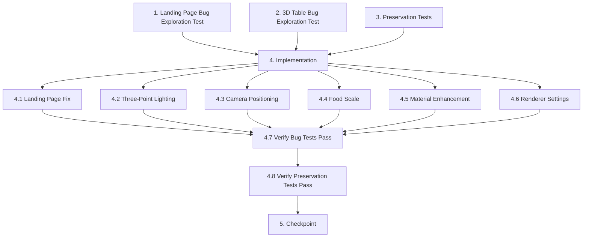

# Implementation Plan

## Overview

This task list implements the bugfix for two critical issues: (1) landing page not rendering on fresh visits due to incorrect sessionStorage state initialization in App.jsx, and (2) poor visual quality of the 3D marble table scene requiring enhanced lighting, camera positioning, food scaling, and PBR materials. The workflow follows the exploratory bugfix methodology: write bug condition tests first to understand the bugs (tasks 1-2), write preservation tests to capture existing behavior (task 3), implement fixes (task 4), and validate all tests pass (task 5).

## Task Dependency Graph

## Tasks

### Bug Condition Exploration Tests (BEFORE FIX)

- [ ] 1. Write bug condition exploration test for landing page
  - **Property 1: Bug Condition** - Landing Page Not Rendering on Fresh Visit
  - **CRITICAL**: This test MUST FAIL on unfixed code - failure confirms the bug exists
  - **DO NOT attempt to fix the test or the code when it fails**
  - **NOTE**: This test encodes the expected behavior - it will validate the fix when it passes after implementation
  - **GOAL**: Surface counterexamples that demonstrate the landing page is skipped on fresh visits
  - **Scoped PBT Approach**: Test the concrete scenario where sessionStorage is empty/null
  - Test implementation: Clear sessionStorage, load app, assert LandingPage renders first
  - Verify sessionStorage key 'etoile-entered' is null or undefined on fresh load
  - Assert that LandingPage component is visible in the DOM
  - Assert that main app content (Reservation, MenuFlipbook) is NOT visible initially
  - Run test on UNFIXED code
  - **EXPECTED OUTCOME**: Test FAILS (landing page doesn't show - confirms bug exists)
  - Document counterexamples found (e.g., "sessionStorage is null but main app renders instead of landing page")
  - Mark task complete when test is written, run, and failure is documented
  - _Requirements: 2.1_

- [ ] 2. Write bug condition exploration test for 3D table visual quality
  - **Property 1: Bug Condition** - 3D Table Poor Visual Quality
  - **CRITICAL**: This test MUST FAIL on unfixed code - failure confirms the bug exists
  - **DO NOT attempt to fix the test or the code when it fails**
  - **NOTE**: This test encodes the expected behavior - it will validate the fix when it passes after implementation
  - **GOAL**: Surface counterexamples that demonstrate poor visual quality (insufficient lighting, bad materials, poor camera angle)
  - **Scoped PBT Approach**: Test that the 3D scene has inadequate lighting setup and basic materials
  - Test implementation: Load MarbleTable3D component, inspect scene graph using Three.js
  - Assert scene has at least 4 lights (three-point + ambient/hemisphere)
  - Assert food group scale is >= 1.6 for visibility
  - Assert camera has perspective depth (not directly overhead)
  - Assert materials have clearcoat properties (marble, plates)
  - Assert shadow map resolution is >= 2048x2048
  - Run test on UNFIXED code
  - **EXPECTED OUTCOME**: Test FAILS (only 2 lights, food scale 1.4, no clearcoat - confirms poor quality)
  - Document counterexamples found (e.g., "Scene has only 2 lights instead of 4+, materials lack clearcoat")
  - Mark task complete when test is written, run, and failure is documented
  - _Requirements: 2.2_

## Preservation Property Tests (BEFORE FIX)

- [ ] 3. Write preservation property tests (BEFORE implementing fix)
  - **Property 2: Preservation** - Application Functionality and 3D Interactivity
  - **IMPORTANT**: Follow observation-first methodology
  - Observe behavior on UNFIXED code for all non-buggy interactions
  - Test navigation: header links, scroll-to-section, mobile menu work correctly
  - Test 3D interactions: drag rotation, click events on dishes/props, zoom controls, auto-tour functionality
  - Test reservation form: submission, validation, state management work correctly
  - Test menu flipbook: pagination, filtering, search, dish modals work correctly
  - Test concierge chat: opening, message sending, recommendations work correctly
  - Test theme toggle: dark/light mode switching works correctly
  - Write property-based tests capturing all observed behaviors
  - Verify tests PASS on UNFIXED code
  - **EXPECTED OUTCOME**: Tests PASS (confirms baseline behavior to preserve)
  - Mark task complete when tests are written, run, and passing on unfixed code
  - _Requirements: 3.1, 3.2, 3.3, 3.4_

## Implementation Tasks

- [ ] 4. Fix landing page rendering and enhance 3D table visual quality

  - [ ] 4.1 Implement landing page fix in App.jsx
    - Strengthen sessionStorage check with explicit null handling
    - Wrap check in try-catch for SSR/storage unavailable scenarios
    - Change: `useState(() => sessionStorage.getItem('etoile-entered') === '1')`
    - To: `useState(() => { try { return sessionStorage.getItem('etoile-entered') === '1'; } catch { return false; } })`
    - Add defensive initialization ensuring storage is accessible
    - Verify landed state is actually false on fresh loads
    - _Bug_Condition: isBugCondition_LandingPage(appState) where sessionStorage.getItem('etoile-entered') === null AND landed === true_
    - _Expected_Behavior: Landing page SHALL display first on fresh visits before main app (Property_LandingPage)_
    - _Preservation: All navigation, forms, chat, menu, reservation features remain unchanged_
    - _Requirements: 2.1, 3.1, 3.2, 3.3_

  - [ ] 4.2 Implement three-point lighting system in MarbleTable3D.jsx
    - **Key Light Enhancement**: Update existing directional light
      - Change color to '#FFDBA8' (warmer), increase intensity to 4.5
      - Adjust position to `(-5, 12, -6)` for more dramatic angle
      - Increase shadow map size to `2048x2048` for softer shadows
      - Set shadow bias to `-0.0003`
      - Configure shadow camera frustum (left: -10, right: 10, top: 10, bottom: -10, near: 0.5, far: 25)
    - **Fill Light**: Add new directional light to soften shadows
      - Color: '#9B7DFF', intensity: 1.2
      - Position: `(4, 8, 3)`
    - **Rim/Back Light**: Add new directional light for depth
      - Color: '#FFE4B5', intensity: 2.0
      - Position: `(0, 5, 6)` behind the table
    - **Hemisphere Light Adjustment**: Reduce intensity to 0.8
      - Colors: '#F5D7FF' (sky), '#271520' (ground)
    - _Bug_Condition: isBugCondition_3DQuality(scene) where scene.lights.length < 3_
    - _Expected_Behavior: Scene SHALL render with dramatic three-point lighting (Property_3DQuality)_
    - _Preservation: 3D table interactivity (drag, click, zoom, auto-tour) remains unchanged_
    - _Requirements: 2.2, 3.4_

  - [ ] 4.3 Enhance camera positioning for cinematic depth
    - Modify updateCamera function for better perspective
    - Increase depth factor: `Math.sqrt(s.zoom * s.zoom + (s.zoom * 0.7) ** 2)`
    - Raise camera target: `cameraTarget.set(visibleHalfWidth - 0.08, 0.3, 0.2)`
    - Adjust camera position for angled view:
      - x: `cameraTarget.x`
      - y: `s.zoom * 0.92` (slightly lower)
      - z: `-s.zoom * 0.65` (pull back more for perspective)
    - _Bug_Condition: isBugCondition_3DQuality(scene) where scene.cameraAngle !== OPTIMAL_SHOWCASE_ANGLE_
    - _Expected_Behavior: Camera SHALL provide optimized angle with cinematic depth (Property_3DQuality)_
    - _Preservation: 3D camera zoom and drag controls remain unchanged_
    - _Requirements: 2.2, 3.4_

  - [ ] 4.4 Increase food scale for better visibility
    - Change food group scale from 1.4 to 1.7
    - Update line 225: `g.scale.setScalar(1.7);`
    - _Bug_Condition: isBugCondition_3DQuality(scene) where scene.foodScale < MINIMUM_VISIBLE_THRESHOLD_
    - _Expected_Behavior: Food items SHALL be clearly visible and properly scaled (Property_3DQuality)_
    - _Preservation: 3D food click events and interactions remain unchanged_
    - _Requirements: 2.2, 3.4_

  - [ ] 4.5 Enhance materials with PBR properties
    - **Marble/Wood Table Slab**: Upgrade to MeshPhysicalMaterial
      - Add clearcoat: 0.45, clearcoatRoughness: 0.25
      - Set roughness: 0.28, metalness: 0.08, reflectivity: 0.6
    - **Gold Accents**: Enhance material properties
      - Set roughness: 0.18, metalness: 0.95
      - Add clearcoat: 0.3, clearcoatRoughness: 0.2, reflectivity: 0.8
    - **Steak Texture**: Refine MeshStandardMaterial
      - Set roughness: 0.25, metalness: 0.12
      - Add subtle emissive: '#1a0a05', emissiveIntensity: 0.15
    - **Plate Material**: Upgrade to MeshPhysicalMaterial for glazed ceramic
      - Set roughness: 0.10, metalness: 0.02
      - Add clearcoat: 0.55, clearcoatRoughness: 0.15, reflectivity: 0.5
    - _Bug_Condition: isBugCondition_3DQuality(scene) where scene.materialQuality === BASIC_STANDARD_
    - _Expected_Behavior: Materials SHALL have enhanced PBR properties with clearcoat and refined properties (Property_3DQuality)_
    - _Preservation: All material visual behaviors remain compatible with existing lighting_
    - _Requirements: 2.2, 3.4_

  - [ ] 4.6 Optimize renderer settings for quality
    - Maintain PCFSoftShadowMap for soft shadows
    - Set tone mapping: `THREE.ACESFilmicToneMapping`
    - Set tone mapping exposure: 1.15 (slightly brighter)
    - Ensure output color space: `THREE.SRGBColorSpace`
    - _Bug_Condition: isBugCondition_3DQuality(scene) where scene.shadowQuality === LOW_
    - _Expected_Behavior: Renderer SHALL produce soft realistic shadows with proper color space (Property_3DQuality)_
    - _Preservation: Renderer performance characteristics maintained (60fps target)_
    - _Requirements: 2.2, 3.4_

  - [ ] 4.7 Verify bug condition exploration tests now pass
    - **Property 1: Expected Behavior** - Landing Page and 3D Quality Fixed
    - **IMPORTANT**: Re-run the SAME tests from tasks 1 and 2 - do NOT write new tests
    - Re-run landing page test from task 1: sessionStorage empty → Landing page should render
    - **EXPECTED OUTCOME**: Test PASSES (confirms landing page bug is fixed)
    - Re-run 3D table test from task 2: scene has 4+ lights, food scale 1.7, materials have clearcoat
    - **EXPECTED OUTCOME**: Test PASSES (confirms 3D quality is enhanced)
    - _Requirements: 2.1, 2.2_

  - [ ] 4.8 Verify preservation tests still pass
    - **Property 2: Preservation** - No Regressions in Functionality
    - **IMPORTANT**: Re-run the SAME tests from task 3 - do NOT write new tests
    - Re-run all preservation property tests from task 3
    - Verify navigation, 3D interactions, forms, menu, chat, theme toggle all work identically
    - **EXPECTED OUTCOME**: Tests PASS (confirms no regressions)
    - Confirm all functionality preserved after fixes
    - _Requirements: 3.1, 3.2, 3.3, 3.4_

- [ ] 5. Checkpoint - Ensure all tests pass
  - Run complete test suite (bug condition + preservation tests)
  - Verify landing page displays on fresh visits
  - Verify 3D table has professional visual quality
  - Verify all existing app functionality works identically
  - Verify performance remains smooth (60fps target on 3D scene)
  - Ask user if any issues or questions arise

## Notes

- **Critical**: Tasks 1-2 (bug condition exploration) and task 3 (preservation) MUST be completed BEFORE task 4 (implementation)
- **Testing Approach**: Bug exploration tests will FAIL on unfixed code (this is expected and confirms bugs exist)
- **Preservation Tests**: Must PASS on unfixed code to establish baseline behavior
- **Timeline**: URGENT - deadline jam 1. Focus on core fixes: landing page state and 3D visual enhancements
- **Performance Target**: Maintain 60fps on 3D scene after visual quality improvements
- **Property-Based Testing**: Use PBT format with "Property N:" for hover status support in IDE
- **Verification**: Re-run the SAME tests from tasks 1-3 in tasks 4.7-4.8 (do NOT write new tests)
